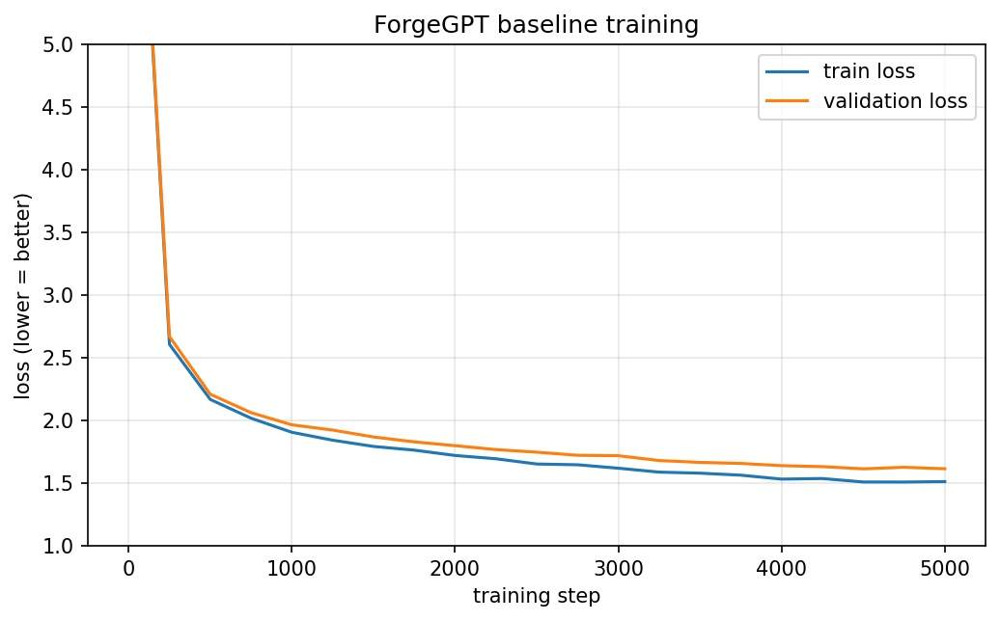
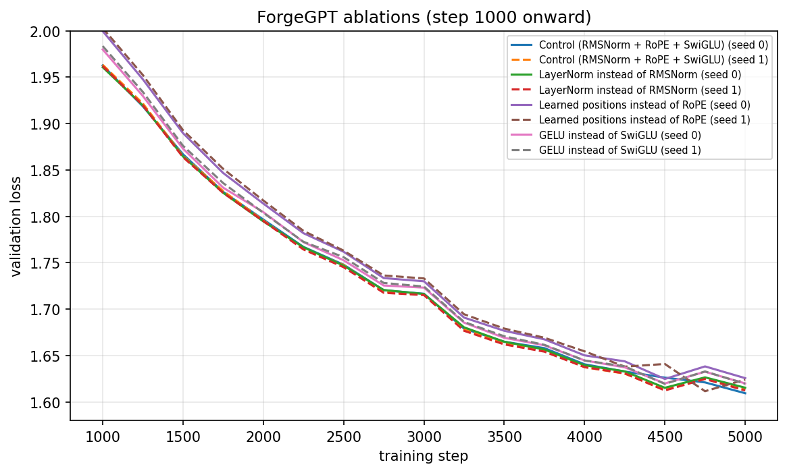

# ForgeGPT

**A GPT-style language model built and trained from scratch in PyTorch, with architecture ablations.**

ForgeGPT implements every part of a modern decoder-only transformer by hand: no pretrained weights and no Hugging Face model classes. It has its own BPE tokenizer, RoPE, RMSNorm, SwiGLU, KV-cache generation, and a resumable mixed-precision training loop. It was trained on a free Google Colab T4 GPU and writes simple children's stories.

**Model weights:** [huggingface.co/syedasumayya1/forgegpt-12m](https://huggingface.co/syedasumayya1/forgegpt-12m)

---

## Highlights

- 12.2M-parameter model trained from scratch on TinyStories (about 70M tokens)
- Validation loss **1.615**, perplexity **5.03** on stories it never saw
- Own BPE tokenizer (4,096 tokens) trained on the data
- KV-cache generation verified to produce **identical output** to uncached generation, with a 2.5x to 5.0x speedup when generating 32 stories at once
- Ablation study of three modern components, run with two seeds so the results can be judged against noise
- Bits-per-character comparison against GPT-2 small on the same validation stories
- Training survives Colab disconnects (atomic checkpoints and auto-resume)

---

## What is implemented

| Component | What it does |
|---|---|
| BPE tokenizer | Splits text into 4,096 subword tokens (trained with the `tokenizers` library) |
| Causal self-attention | Each token attends only to earlier tokens (6 heads) |
| RoPE | Rotary position embeddings: encodes word order by rotating query and key vectors |
| RMSNorm | Lightweight normalization that keeps activations at a stable scale |
| SwiGLU | Gated feed-forward layer |
| Residual connections | Each sub-layer adds to its input, so earlier information is kept |
| Weight tying | The output layer shares weights with the token embedding |
| KV-cache | Reuses past keys and values during generation |
| Sampling | Temperature, top-k and top-p |
| Training engine | AdamW, warmup and cosine learning-rate schedule, gradient accumulation, gradient clipping, fp16 mixed precision, atomic checkpoints with auto-resume |

The code includes sanity tests: the starting loss matches random guessing (8.37 vs ln 4096 = 8.32), and a causality test confirms that changing a future token never changes earlier predictions.

---

## Model and training setup

| Setting | Value |
|---|---|
| Parameters | 12.2M |
| Layers / heads / embedding size | 6 / 6 / 384 |
| Context length | 256 tokens |
| Vocabulary | 4,096 (own BPE tokenizer) |
| Training data | TinyStories, first 300,000 stories (69.9M tokens) |
| Validation data | 10,000 stories (2.1M tokens), never used for training |
| Steps | 5,000 |
| Effective batch | 128 sequences x 256 tokens = 32,768 tokens per step (about 164M tokens seen) |
| Optimizer | AdamW, peak learning rate 1e-3 decaying to 1e-4, weight decay 0.1 |
| Hardware | Google Colab T4, about 95,000 tokens/sec, about 30 minutes per run |

---

## Results

### Training curve



Final validation loss was **1.615** (perplexity **5.03**). Final training loss was about 1.51, so the train/validation gap is small (about 0.1). The model is learning general patterns, not memorizing the training stories.

### Sample generations

Prompt: `Once upon a time, there was a little dog named Max.`

**Temperature 0.8** (best balance):

> Once upon a time, there was a little dog named Max. Max liked to play outside and chase his ball. One day, Max saw a big slide and wanted to go down it. But it was too steep for him. So, Max decided to be careful and go down the slide. As Max was running down the slide, he saw a man walking by. The man had a big red hat and a long beard. [...]

**Temperature 1.2** (too random; note the invented word "heets" and the incoherent phrasing):

> [...] When they got to the airport, Max's eyes were full of heets. He saw so many things to watch and see how they felt. [...]

At temperature 0.3 the stories are clean but repetitive, and their logic can still slip. Full samples are in [results/samples.md](results/samples.md).

### Ablation study

Each variant changes **one** component of the baseline (RMSNorm + RoPE + SwiGLU). All runs use the same data, the same data order, the same hyperparameters and 5,000 steps. "Avg of last 3 evals" smooths evaluation noise. Each variant is compared only with the control run that used the **same seed**.

| Variant | Seed | Final val loss | Avg of last 3 evals | Perplexity | vs matching control |
|---|---|---|---|---|---|
| Control (RMSNorm + RoPE + SwiGLU) | 0 | 1.609 | 1.608 | 4.99 | n/a |
| Control (RMSNorm + RoPE + SwiGLU) | 1 | 1.613 | 1.617 | 5.04 | n/a |
| LayerNorm instead of RMSNorm | 0 | 1.615 | 1.619 | 5.05 | +0.011 |
| Learned positions instead of RoPE | 0 | 1.626 | 1.629 | 5.10 | +0.021 |
| Learned positions instead of RoPE | 1 | 1.624 | 1.625 | 5.08 | +0.008 |
| GELU instead of SwiGLU | 0 | 1.620 | 1.624 | 5.07 | +0.016 |
| GELU instead of SwiGLU | 1 | 1.620 | 1.624 | 5.07 | +0.007 |

Full table with every run: [results/ablation_table.md](results/ablation_table.md)



**Interpretation:**

- In every comparison in the table above, the older design scored slightly worse than the control, but only by **0.007 to 0.021** in validation loss (at most about 2% in perplexity).
- The two control seeds differ by 0.009, so any single difference is close to the noise level. No individual result is statistically significant.
- The consistent direction across seeds is mild evidence that the modern components help a little at this scale. It is not proof.
- The learned-position model has slightly more parameters (12.3M vs 12.2M) and still did not win.
- The seed-1 learned-position run was resumed from a step-4000 checkpoint after a Colab disconnect. After a resume, training batches are drawn with a different random seed than in an uninterrupted run, which is a minor difference.
- The benefit of modern components is generally expected to grow with model size and training length. This experiment does not test that.

### KV-cache speed

Greedy generation (temperature 0), seconds per generation. Cached and uncached outputs were verified to be identical.

| New tokens | Batch 1: no cache | Batch 1: KV-cache | Speedup | Batch 32: no cache | Batch 32: KV-cache | Speedup |
|---|---|---|---|---|---|---|
| 50 | 0.44 s | 0.28 s | 1.6x | 0.73 s | 0.29 s | 2.5x |
| 100 | 0.56 s | 0.58 s | 1.0x | 1.64 s | 0.58 s | 2.8x |
| 200 | 1.36 s | 1.13 s | 1.2x | 5.82 s | 1.17 s | 5.0x |

At batch size 1 this model is so small that Python and kernel-launch overhead dominates, so the cache helps little and the timings are noisy. With 32 sequences at once there is enough real computation for the cache to matter, and the speedup grows with sequence length.

### Comparison with GPT-2

Perplexity cannot be compared directly because the tokenizers differ (4,096 vs 50,257 tokens), so each token covers a different amount of text. Instead, both models are scored in **bits per character** on the same 1,000 TinyStories validation stories (only stories that fit in ForgeGPT's 256-token context). Lower is better.

Full results: [results/gpt2_comparison.md](results/gpt2_comparison.md)

This is a comparison of a small in-domain model against a model 10x larger that never saw this kind of text. It is **not** a comparison between equals, and it should not be read as ForgeGPT being a better language model than GPT-2.

---

## Limitations

- The model was trained only on simple children's stories, so it cannot answer questions or write about other topics.
- Story logic is weak: sentences are fluent, but plots sometimes contradict themselves.
- The ablations are small-scale (12M parameters, 5,000 steps, one or two seeds per variant). They cannot tell us which components matter at larger scale.
- Context length is limited to 256 tokens.
- The GPT-2 comparison scores only stories that fit in 256 tokens, which favors shorter stories (the same stories are used for both models).

---

## Repository structure

```
forgegpt/
├── forgegpt/
│   ├── config.py      # model and training settings (with ablation switches)
│   ├── model.py       # RMSNorm, RoPE, attention, SwiGLU, GPT
│   ├── data.py        # memory-mapped batch loader
│   ├── train.py       # training loop, checkpoints, resume
│   └── generate.py    # sampling and KV-cache generation
├── results/           # loss curves, ablation table, samples, GPT-2 comparison
└── README.md
```

---

## Reproduce

1. Open a Google Colab notebook with a T4 GPU and clone this repo.
2. Install `tokenizers` and `datasets`.
3. Download TinyStories (first 300,000 training stories and 10,000 validation stories), train the BPE tokenizer with a vocabulary of 4,096, and tokenize the text into `train.bin` and `val.bin` (uint16 token files).
4. Train the baseline:

```python
from forgegpt.config import GPTConfig, TrainConfig
from forgegpt.train import train

train(GPTConfig(), TrainConfig(run_name="base"))
```

5. Run an ablation by changing one switch:

```python
train(GPTConfig(pos_type="learned"), TrainConfig(run_name="abl_learned_pos"))
```

Available switches: `norm_type` (`rmsnorm` / `layernorm`), `pos_type` (`rope` / `learned`), `mlp_type` (`swiglu` / `gelu`).

6. Generate stories:

```python
from forgegpt.generate import generate
out = generate(model, prompt_ids, max_new_tokens=200, temperature=0.8, top_k=40, top_p=0.95)
```

---

## Acknowledgements

- Dataset: [TinyStories](https://huggingface.co/datasets/roneneldan/TinyStories) (Eldan and Li, 2023)
- Architecture choices follow Llama-style models (RoPE, RMSNorm, SwiGLU)
- Inspired by Andrej Karpathy's nanoGPT

## License

MIT
